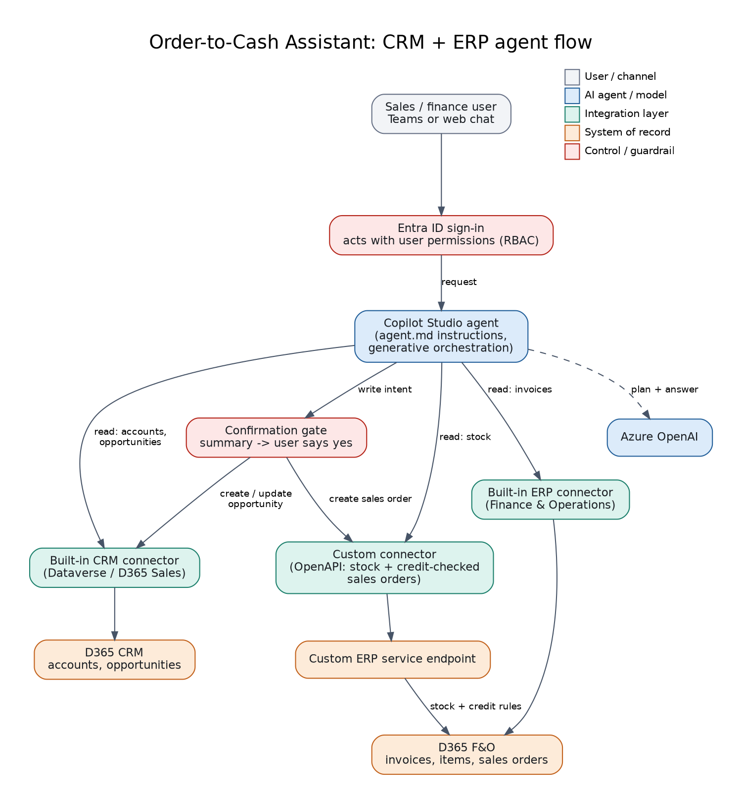

# 01: Order-to-Cash Assistant Agent

A Copilot Studio agent for sales and finance teams that works across **D365 CRM (Sales)** and **Finance & Operations (ERP)** in one conversation. Reads go through the **built-in CRM and ERP connectors**; a **custom connector** covers stock and credit-checked sales orders. Every write is confirmed by the user first.

## What is in this folder
| File | Purpose |
|------|---------|
| `agent.md` | The agent's instructions: paste into Copilot Studio |
| `custom-connector/d365-erp-demo.swagger.yaml` | OpenAPI 2.0 definition for the custom connector (import in Power Apps / Power Automate > Custom connectors) |
| `diagram.png` / `.svg` | Technical flow |

The backing API for the custom connector is [`shared/mock-d365-api`](../shared/mock-d365-api).

## Build it in Copilot Studio
1. Run the mock API and expose it (for example with a dev tunnel or deploy to Azure App Service). Note the host name.
2. Import `custom-connector/d365-erp-demo.swagger.yaml`, set the host, use API key auth (`x-api-key`), test each action.
3. Create an agent, paste `agent.md` (the "Instructions" section) into the agent instructions.
4. Add tools: the built-in **Microsoft Dataverse / Dynamics 365 (CRM)** actions for accounts and opportunities, the built-in **Finance and Operations** actions for ERP reads (if you have an F&O sandbox), and the custom connector actions.
5. Publish to Teams or a web channel.

## Demo script
1. "How is Northwind doing?" -> overview with credit, invoices and opportunities.
2. "Create an order for Northwind: 20 barcode scanners." -> summary and total, asks to confirm, creates `SO-...`.
3. "Create an order for Northwind: 500 handheld terminals." -> explains the stock or credit rule that blocks it.
4. "Give them 10% off." -> declines and offers to route to the account owner.

## Maps to
CV project: *Order-to-Cash Assistant Agent: D365 CRM & ERP Integration*.
