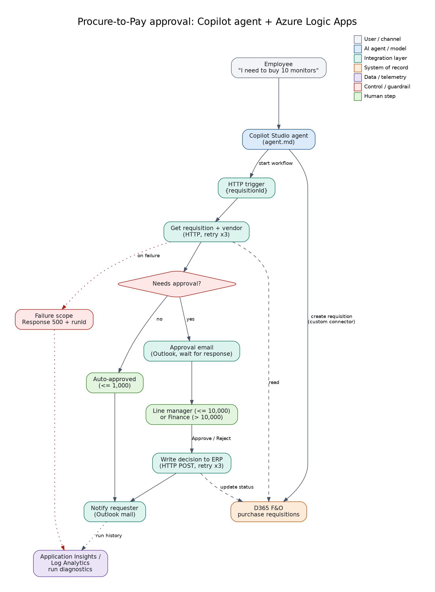

# 02: Procure-to-Pay Approval Automation

A Copilot Studio agent raises a purchase requisition; an **Azure Logic App** (HTTP trigger) validates it against the ERP, routes it for approval by amount, writes the decision back, notifies the requester, and returns a result with a run id for traceability.



## Files
| File | Purpose |
|------|---------|
| `workflow.json` | Logic App (Consumption) code-view definition: trigger, retries (exponential x3), approval email, ERP write-back, notification, success and failure responses |
| `simulate_workflow.py` | Runs the same logic locally against the mock API so you can demo without Azure |
| `sample-request.json` | Example trigger payload |
| `agent.md` | Instructions for the Copilot Studio agent that starts the workflow |

## Approval routes (from the mock ERP)
Up to 1,000: auto-approved. Up to 10,000: manager. Above 10,000: finance. Blocked vendors are refused.

## Try it locally
```bash
cd ../shared/mock-d365-api && uvicorn app:app --port 8000
cd ../../02-procure-to-pay-logic-apps
python simulate_workflow.py --amount 500                        # auto-approved
python simulate_workflow.py --amount 2500 --decision Approved   # manager route
python simulate_workflow.py --amount 40000 --decision Rejected  # finance route
python simulate_workflow.py --amount 300 --vendor VEN-3003      # blocked vendor
```

## Deploy to Azure (optional)
1. Create a Logic App (Consumption). Open **Logic app code view** and paste the `definition` from `workflow.json`.
2. Create the Office 365 Outlook connection and authorize it; set `erpBaseUrl` and `erpApiKey` parameters.
3. Copy the HTTP trigger URL into the MCP server (`LOGIC_APP_URL`) or the agent's tool.
4. Turn on diagnostic settings (Log Analytics / Application Insights) for run history.

> `workflow.json` has not been deployed from this repo. The simulation proves the logic; re-authorize connections and test in your own subscription before presenting it live.

## Maps to
CV project: *Procure-to-Pay Approval Automation: Azure Logic Apps with Copilot Agent*.
