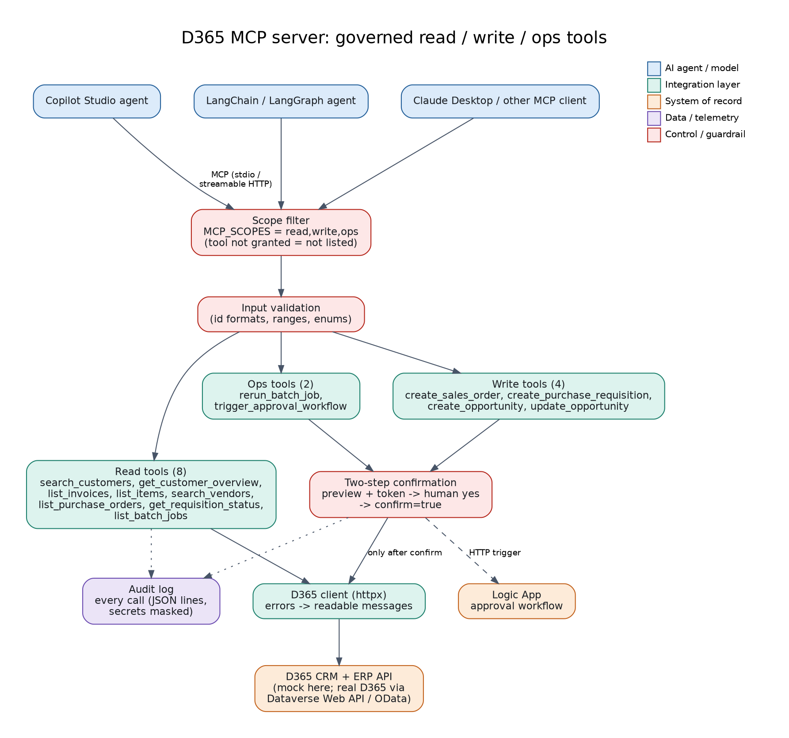

# 03: D365 MCP Server

A **Python MCP server** that exposes Dynamics 365 CRM and ERP capabilities as governed tools, so several agents (Copilot Studio, LangChain / LangGraph, Claude Desktop) share one secure integration layer.



## Design
- **14 tools:** 8 read, 4 write, 2 operations (list in `agent.md`).
- **Scopes:** `MCP_SCOPES=read,write,ops`. A tool that is not granted is not even listed, so a read-only agent cannot write.
- **Two-step writes:** the first call returns a preview and a confirmation token; the agent must get the user's yes and call again with `confirm=true` and the token. A wrong token does nothing.
- **Validation:** id formats, ranges and enums are checked before any call leaves the server.
- **Business-rule errors** (blocked vendor, credit limit, stock) come back as readable messages, not stack traces.
- **Audit log:** every call is written to `audit.log` (JSON lines, secrets masked).

## Run
```bash
pip install -r requirements.txt
# terminal 1: the mock API
cd ../shared/mock-d365-api && uvicorn app:app --port 8000
# terminal 2: the MCP server (stdio)
cd ../../03-d365-mcp-server && MCP_SCOPES=read,write,ops python server.py
# or over HTTP for remote agents:
MCP_SCOPES=read,write,ops python server.py --http
```

Claude Desktop / other stdio clients: add to the MCP config
```json
{ "mcpServers": { "d365-crm-erp": {
  "command": "python", "args": ["/absolute/path/to/03-d365-mcp-server/server.py"],
  "env": { "MCP_SCOPES": "read,write,ops", "D365_API_BASE": "http://localhost:8000", "D365_API_KEY": "demo-key" } } } }
```

## Tests
```bash
pytest -q     # starts its own mock API; 5 tests: scopes, read, confirmation gate, business-rule errors, validation
```

## Demo script
1. "Can Northwind take a 20-unit order of barcode scanners?" (read tools)
2. "Raise a requisition for 2,500 with Globex for monitors." (preview -> yes -> created, manager route)
3. "Raise one with Umbrella Parts." (blocked vendor explained)
4. "Why did last night's batch fail?" then "Re-run it." (ops tool with confirmation)
5. Open `audit.log` to show every call recorded.

Uses MCP Python SDK 2.x (`MCPServer`). If you pin SDK 1.x, import `FastMCP` from `mcp.server.fastmcp` instead.

## Maps to
CV project: *D365 MCP Server: Read, Write & Operations Tools for AI Agents*.
