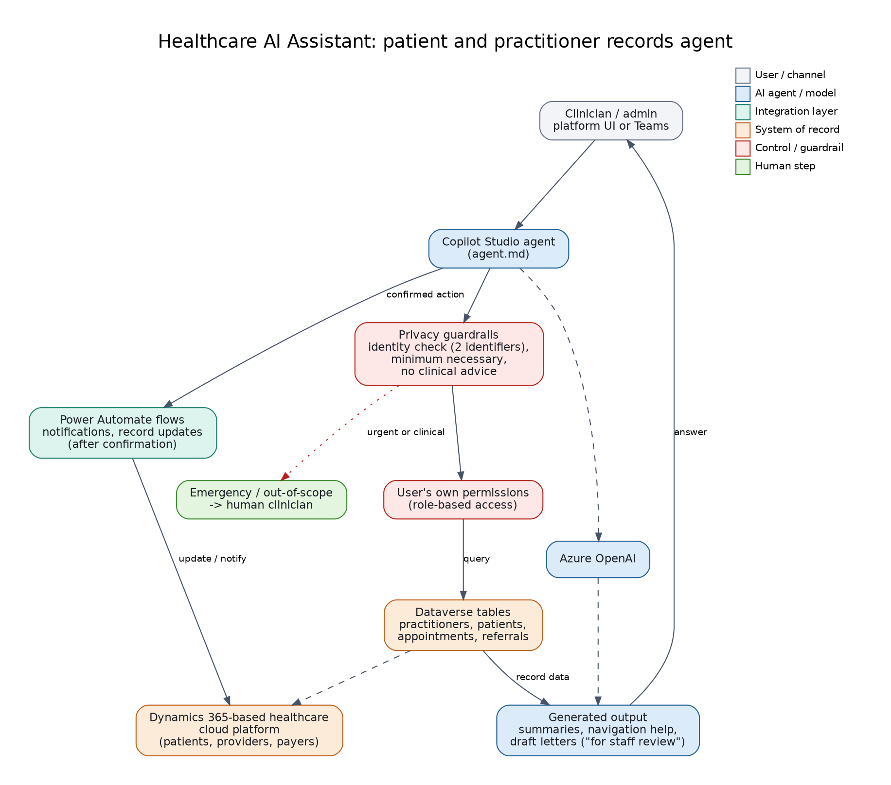

# 04: Healthcare AI Assistant (patient and practitioner records agent)

A Copilot Studio agent embedded in a Dynamics 365-based healthcare cloud platform that connects patients, providers and payers. Staff ask natural-language questions about practitioners and patient records, get summaries and navigation help, generate draft letters, and trigger Power Automate flows for notifications and record updates.

**Status: reference design.** The agent instructions and architecture are here. Build it in Copilot Studio against **fictional** Dataverse tables. Never load real patient data into a demo.

## Files
`agent.md`: the agent instructions (privacy rules, identity check, no clinical advice, escalation). `diagram.png`: flow.

## Suggested demo data model (Dataverse, fictional)
| Table | Key columns |
|-------|-------------|
| Practitioner | Name, Specialty, Location, Availability, Phone |
| Patient | Name, DateOfBirth, Phone, PrimaryPractitioner |
| Appointment | Patient, Practitioner, DateTime, Status |
| Referral | Patient, FromPractitioner, ToSpecialty, Status |

## Build steps
1. Create the tables above in a developer environment and add ~15 fictional rows.
2. Create the agent, paste `agent.md` instructions; add Dataverse "list rows" tools scoped to those tables.
3. Add a Power Automate flow for "send appointment reminder" and "update referral status" as tools.
4. Test identity check (wrong date of birth must be refused), access denial, and the clinical-advice refusal.

## Demo script
"Find a cardiologist in Karachi." -> "Summarise upcoming appointments for Jane Doe, date of birth 1 Mar 1980." -> "Draft a referral cover note." -> "Should I increase her dose?" (refuses and routes to clinician).

## Maps to
CV project: *Healthcare AI Assistant: Patient & Practitioner Records Agent (MazikCare)*. Product reference: <https://mazikglobal.com.pk/products/mazikcare/>
