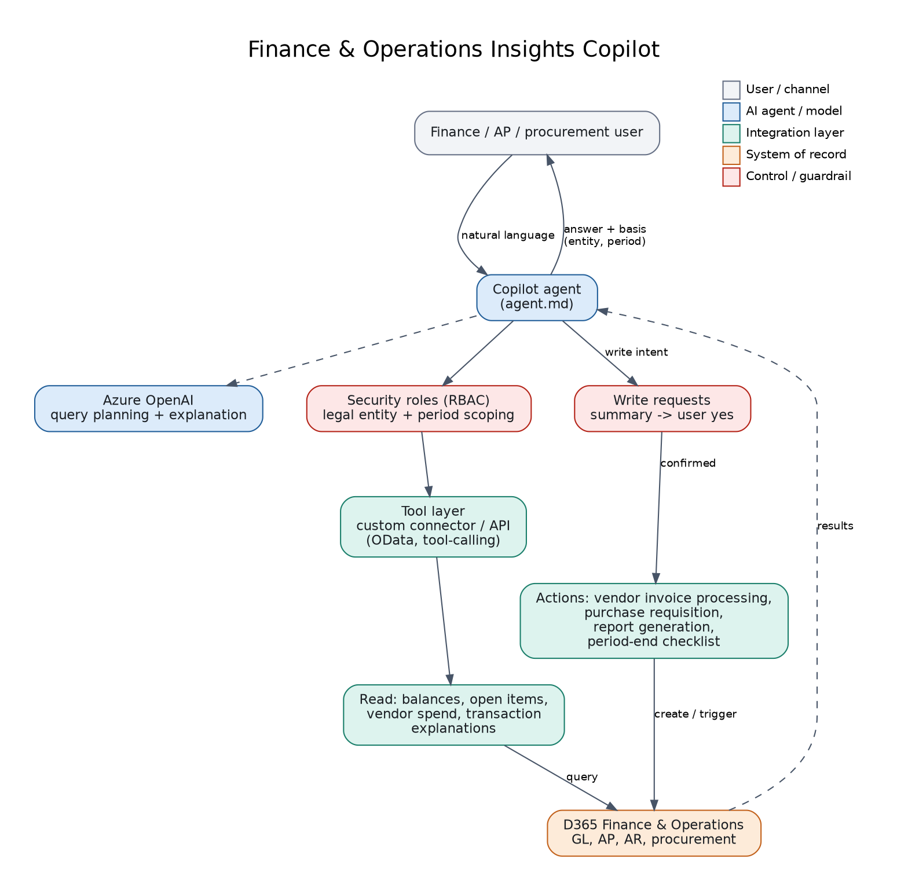

# 05: Finance & Operations Insights Copilot

An agent that answers finance and procurement questions from D365 Finance & Operations data, explains transactions in plain language, and runs a small set of controlled actions (vendor invoice processing, requisitions, report generation, period-end checklist) after confirmation.

**Status: reference design.** `agent.md` and the architecture are included. To demo without an F&O environment, connect the agent to the shared mock API (`../shared/mock-d365-api`) through the custom connector in project 01 or the MCP server in project 03.

## Files
`agent.md`: instructions (answer format with entity, currency and period; read-first; confirmation for writes). `diagram.png`: flow.

## Build steps
1. Create the agent in Copilot Studio and paste `agent.md`.
2. Add tools: F&O connector actions (or the custom connector / MCP server), plus a Power Automate flow for report generation.
3. Test: scoping answers by legal entity and period, access denial, refusal to post or reverse journals.

## Demo script
"Which vendors do we owe the most?" -> "Explain invoice INV-4004." -> "Raise a requisition for office chairs, 3,200, with Globex."

## Maps to
CV project: *Copilot for Dynamics 365 Finance & Operations*.
