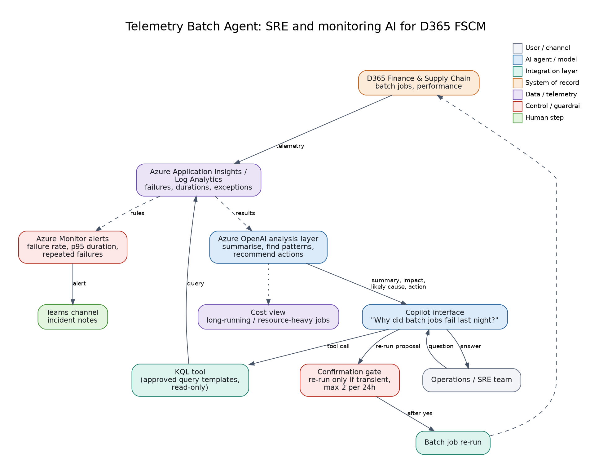

# 06: Telemetry Batch Agent (SRE + monitoring AI)

An agent for operations teams that monitors Dynamics 365 Finance & Supply Chain batch jobs and performance using **Azure Application Insights** telemetry. It summarises what happened, finds recurring failures, recommends fixes, and offers confirmed re-runs. Alerting follows SRE practice (symptoms, not causes).

**Status: reference design with KQL templates.** The KQL files are illustrative: adjust table and `customDimensions` names to the telemetry your environment emits.

## Files
| File | Purpose |
|------|---------|
| `agent.md` | Agent instructions: answer structure (summary, impact, likely cause, pattern, action), guard rails for re-runs |
| `kql/batch_failures.kql` | Failures in the last 24h by job |
| `kql/batch_duration_trend.kql` | p50 / p95 duration per job over 7 days |
| `kql/exceptions_by_operation.kql` | Exceptions linked to operations |

## Build steps
1. Send D365 telemetry to Application Insights (Power Platform admin center / LCS monitoring and telemetry).
2. Wrap the KQL templates as read-only tool calls (Logic App, Function or MCP tool).
3. Create the agent with `agent.md`; add the re-run tool behind a confirmation step.
4. Create Azure Monitor alerts on failure rate and p95 duration; route to Teams.

To try the conversation without telemetry, point the agent at project 03's `list_batch_jobs` and `rerun_batch_job` tools (mock data includes a failed "Inventory closing" job).

## Demo script
"Why did batch jobs fail last night?" -> structured answer -> "Re-run it." (asks to confirm).

## Maps to
CV project: *Telemetry Batch Agent for D365 FSCM: SRE & Monitoring AI*.
