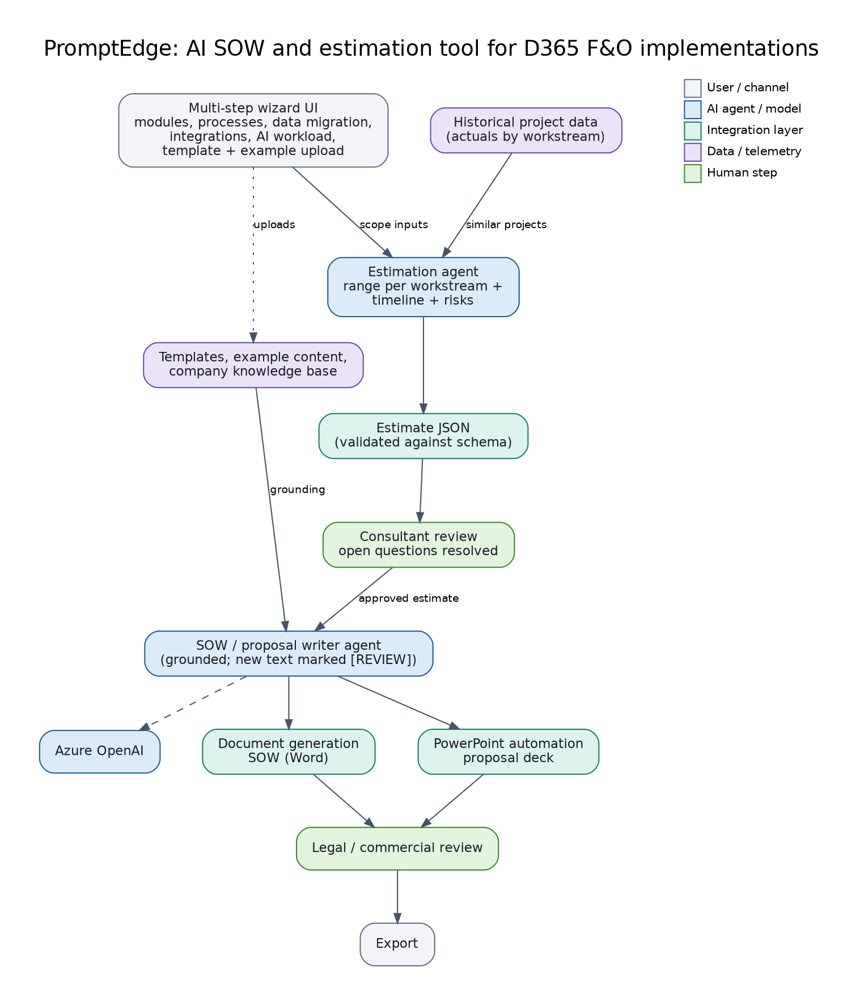

# 07: PromptEdge, AI SOW & Estimation for D365 Finance & Operations

Built from hands-on experience of a full D365 Finance & Operations implementation. A multi-step wizard collects scope (modules, processes, data migration, integrations, AI workload). An **estimation agent** predicts effort and timeline from historical projects; a **SOW and proposal writer agent** then generates the SOW and deck from the approved estimate, templates and example content.

**Status: reference design.** `agent.md` defines both agents; `schema/estimate.schema.json` is the contract between them.

## Files
`agent.md` (Agent A: estimation, Agent B: SOW writer), `schema/estimate.schema.json`, `diagram.png`.

## Build steps
1. Store historical project actuals (workstream, modules, effort) in a table or Dataverse.
2. Implement `find_similar_projects` and `search_knowledge` as tools; validate agent output against the schema.
3. Generate Word with a template engine and PowerPoint from the slide JSON; keep template clause text verbatim.
4. Add a review step: consultant for the estimate, legal/commercial for the SOW.

## Demo script
Choose GL, AP, AR, Procurement; 2 entities; migration of vendors and open balances; 3 integrations -> estimate with ranges and risks -> SOW and deck.

## Maps to
CV project: *PromptEdge: AI-Powered SOW & Estimation Tool for D365 Finance & Operations*.
