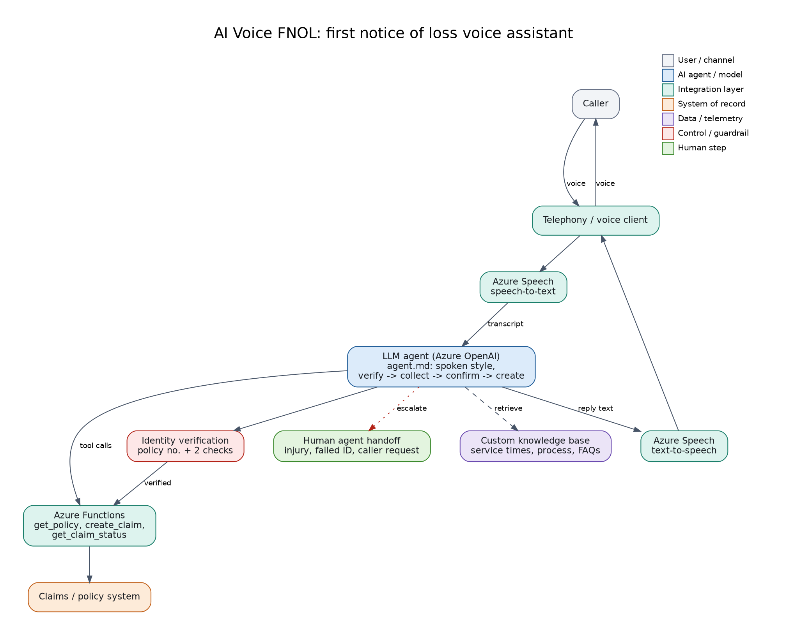

# 08: AI Voice-Based FNOL (First Notice of Loss)

A voice assistant that takes a first notice of loss call: verifies identity, collects claim details, creates the claim and gives status updates. Pipeline: telephony -> **Azure Speech** (speech-to-text) -> **LLM agent** with a custom knowledge base -> **Azure Functions** tools -> claims system -> **Azure Speech** (text-to-speech).

**Status: reference design.** `agent.md` is written for spoken delivery (short sentences, read-backs, safe handoff).

## Files
`agent.md` (voice instructions, call flow, handoff rules), `diagram.png`.

## Build steps
1. Create Azure Speech and Azure OpenAI resources.
2. Implement tools as Azure Functions: `get_policy`, `create_claim`, `get_claim_status` (start with a mock data source).
3. Build the loop: audio -> STT -> LLM (with `agent.md` and tools) -> TTS. Test with a browser microphone or a telephony provider.
4. Test: failed identity check (transfer), injury mention (safety message), caller asks for a human.

## Maps to
CV project: *AI Voice-Based FNOL*.
