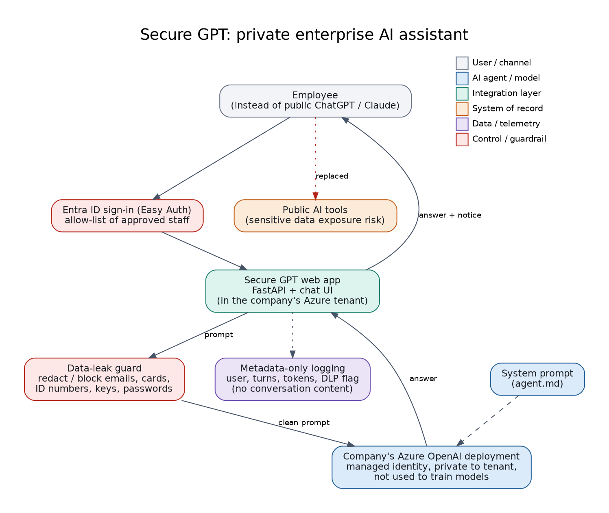

# 09: Secure GPT, private enterprise AI assistant

**Why:** employees were using public tools such as ChatGPT and Claude for daily work, which risks exposing sensitive company data. The client wanted an assistant that feels like those tools but keeps data inside the organisation.

**What:** a chat app (FastAPI + simple UI) deployed in the company's Azure tenant that talks to the company's own **Azure OpenAI** deployment.



## Controls
- **Sign-in and allow-list:** designed for Azure App Service Easy Auth (Entra ID); `REQUIRE_AUTH=true` + `ALLOWED_USERS`.
- **Data-leak guard (`dlp.py`):** detects emails, card numbers (Luhn-checked), ID numbers, IBANs, API keys and password assignments; mode `off | warn | redact | block`.
- **Managed identity:** no API key needed in Azure (`DefaultAzureCredential`).
- **No conversation storage;** logs contain metadata only (user, turns, tokens, whether the guard fired).
- **System prompt:** `agent.md` is loaded as the system prompt.

## Run
```bash
pip install -r requirements.txt
uvicorn app:app --port 8100          # offline demo mode if AZURE_OPENAI_ENDPOINT is empty
# open http://localhost:8100
pytest -q                             # guard, redaction, block mode, allow-list
```
Set `AZURE_OPENAI_ENDPOINT` and `AZURE_OPENAI_DEPLOYMENT` (see `.env.example`) to use a real deployment. Offline mode only echoes the (redacted) prompt, so you can demo the guard without Azure. The Azure call itself is not covered by the tests.

## Demo script
1. Send "Summarise this: contact jane@corp.com, card 4111 1111 1111 1111" -> notice shows the data was removed before sending.
2. Switch `DLP_MODE=block` -> the same message is refused with a clear reason.
3. Set `REQUIRE_AUTH=true` -> unauthenticated or non-approved users are refused.

## Maps to
CV project: *Secure GPT: Private Enterprise AI Assistant*.
