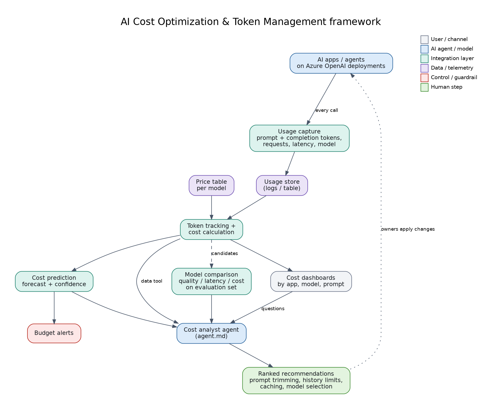

# 10: AI Cost Optimization & Token Management Framework

Tracks token usage and cost for Azure OpenAI workloads, finds waste, compares models and forecasts spend, and an analyst agent turns this into ranked recommendations.



## Files
| File | Purpose |
|------|---------|
| `cost_report.py` | Generates synthetic usage, then reports cost by app and model, waste signals and a run-rate forecast |
| `agent.md` | Instructions for the cost analyst agent |
| `diagram.png` | Flow |

## Run
```bash
python cost_report.py --generate      # creates usage.csv (synthetic, not real usage)
python cost_report.py
```
Prices in the script are **illustrative placeholders**; edit `PRICES` with your own per-million-token prices. For real workloads, feed the same columns from Azure OpenAI diagnostic logs / your usage collector.

## Maps to
CV project: *AI Cost Optimization & Token Management Framework*.
